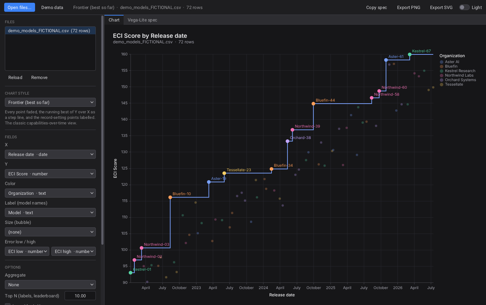

# Raven Charts

A desktop chart viewer. The UI is [Raven](../../README.md) and the charts are [Vega-Lite](https://vega.github.io/vega-lite/).
Open CSV, TSV or JSON files (for example the Epoch AI Capabilities Index export), pick a chart style and the fields, and export the result.



## How it works

| Part | Role |
|---|---|
| `ui/main.xml` + `src/main.c` | The Raven window: the file list, the style picker, the field pickers, the options, the spec editor, exports, drag and drop |
| `<WebView>` (`raven_web`) | Shows `web/chart.html` in a hidden Chromium-family browser that is already installed (Edge, Chrome, Chromium, Brave) |
| `web/chart.js` | Parses the files, infers the field types, builds the Vega-Lite spec for each style, and draws it |
| `web/vendor/` | Vega 5.33.0, Vega-Lite 5.23.0 and vega-embed 6.29.0 ship with the app, so it works offline (BSD-3-Clause) |

Raven calls `window.RC.*` with `Rweb_view_run_javascript`. The page answers with `window.raven.postMessage("kind\nbody")`.
Raven reads the files itself because the embedded browser has no file chooser.

## Build

You need Raven's own requirements (CMake, a C11 compiler, the X11 headers on Linux, a Vulkan driver), plus an installed Chromium-family browser at run time.

```bash
cmake -S apps/raven-charts -B build-charts -DCMAKE_BUILD_TYPE=Release
```

```bash
cmake --build build-charts --parallel
```

```bash
./build-charts/raven_charts                      # or: raven_charts file1.csv file2.json
```

On Windows the program is `build-charts\Release\raven_charts.exe`. If you move the executable, set `RAVEN_CHARTS_DIR` to the folder that holds `ui/`, `web/` and `data/`.
If no browser is found, set `RAVEN_WEB_BROWSER` to its path.

## Using Epoch AI's ECI data

1. Open https://epoch.ai/eci and use its data download button to save the CSV.
2. Click **Open files...** in Raven Charts, or drop the file on the window.
3. The app guesses the fields from the column names:
   - **X**: a release or publication date
   - **Y**: the ECI score
   - **Color**: the organization
   - **Label**: the model name
   - **Error low / high**: confidence-interval columns, if the export has them
4. **Frontier (best so far)** reproduces the release-date view. Turn on **Frontier / trend per color group** to get one frontier per lab.

You can change any guess with the field pickers.

The bundled `data/demo_models_FICTIONAL.csv` is **made-up data** with fictional labs and models. It exists only to try the app and is not Epoch's data.
Epoch's datasets carry their own license and citation terms; check them on their site before you publish charts made from them.

## Chart styles

| Style | Needs | Notes |
|---|---|---|
| Frontier (best so far) | X, Y | Running maximum as a step line, with record-setting points labelled |
| Scatter + labels | X, Y | The Top N by Y get their Label |
| Scatter, Bubble | X, Y (+ Size) | |
| Scatter + linear trend | X, Y | Exponential fit when Y is logarithmic |
| Scatter + smooth (LOESS) | X, Y | |
| Points + error bars | X, Y, low, high | |
| Line, Line + points, Step line, Area | X, Y | Aggregate merges records that share an X |
| Bar | X | Bins numbers and groups dates by month. Aggregate sets the bar height |
| Leaderboard (top N) | Label, Y | Horizontal, sorted |
| Histogram | X | |
| Box plot, Strip plot | Y (+ a text X or Color) | |
| Heatmap (2D bins) | X, Y | |

These options apply to every style: Logarithmic X / Y, a Title, and a **Filter**.
The Filter takes a Vega expression, for example `datum['Organization'] == 'Aster AI'` or `datum['ECI Score'] > 120`.

## Custom charts

- The **Vega-Lite spec** tab shows the spec behind the current chart. Edit it and click **Apply spec**.
- In a spec, `{"data": {"name": "table"}}` is the file selected in the list. Every loaded file is also a named dataset, named after its file (e.g. `demo_models_FICTIONAL`), so one spec can use several files.
- Opening a `.json` file that is a Vega-Lite spec (it has `$schema`, `mark`, `layer`...) draws it as it is.
- **Copy spec** puts the spec on the clipboard. **Export PNG** saves at 2x scale; **Export SVG** saves a vector image.

## Supported files

- CSV, TSV and other delimited text (the delimiter is detected)
- JSON: an array of records, or an object holding one (`data`, `values`, `rows`...)
- JSON Lines (`.jsonl`, `.ndjson`)

Types are inferred per column: number, date (ISO `2024-05-13`, `5/13/2024`, `May 13, 2024`...) or text.
